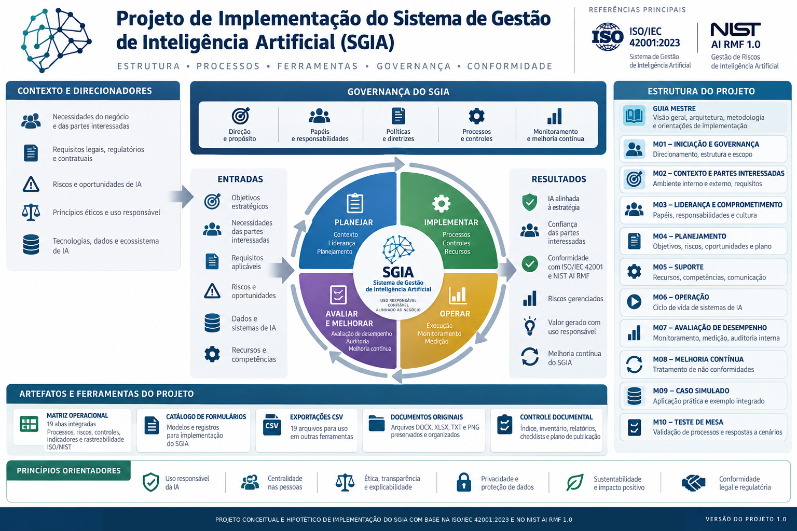

# Projeto de Implementação do Sistema de Gestão de Inteligência Artificial (SGIA)

**Versão do projeto:** 1.0  
**Natureza:** projeto conceitual e hipotético  
**Referência central:** ISO/IEC 42001:2023  
**Autor:** José Eduardo Moura Cardozo

## Apresentação

Este projeto organiza uma abordagem conceitual para planejar e orientar a implementação de um Sistema de Gestão de Inteligência Artificial (SGIA). A proposta conecta governança, contexto organizacional, riscos e impactos, ciclo de vida dos sistemas de IA, dados, transparência, supervisão humana, segurança, avaliação de desempenho e melhoria contínua.

O material foi elaborado como referência técnica conceitual. Ele pode apoiar estudos, planejamento e desenho de processos, mas precisa ser adaptado e avaliado antes de qualquer uso operacional.

> **Limite essencial:** este é um projeto conceitual e hipotético. Não descreve uma implantação em uma organização real, não comprova execução ou eficácia de controles e não declara conformidade nem certificação.

## Arquitetura proposta

1. **M01 — Iniciação, governança, portfólio e business case:** estabelece a justificativa, o patrocínio, a governança e a decisão de iniciar.
2. **M02 — Contexto, escopo, liderança, política e competência:** organiza contexto, escopo, responsabilidades, política e competências.
3. **M03 — Gestão de riscos e oportunidades em IA:** estrutura a identificação, análise, tratamento e acompanhamento de riscos.
4. **M04 — Avaliação de impacto de IA e integração com RIPD:** avalia impactos potenciais e articula avaliações pertinentes de privacidade.
5. **M05 — Ciclo de vida, engenharia, validação e MLOps:** conecta desenvolvimento, validação, implantação, monitoramento e mudanças.
6. **M06 — Governança, qualidade, proveniência e ciclo de vida dos dados:** trata dados como ativos sujeitos a controles de qualidade, origem, acesso e ciclo de vida.
7. **M07 — Transparência, explicabilidade, registros e comunicação:** organiza documentação, comunicação e explicações proporcionais ao contexto.
8. **M08 — Supervisão humana, uso responsável e terceiros:** define pontos de supervisão, responsabilidades e tratamento de dependências externas.
9. **M09 — Segurança da informação, cibersegurança em IA e privacidade:** aborda ameaças, proteção, resposta a incidentes e privacidade.
10. **M10 — Desempenho, auditoria, não conformidade e melhoria:** estrutura indicadores, avaliações, tratamento de falhas e melhoria contínua.

## Como interpretar as referências

A ISO/IEC 42001:2023 é a referência central indicada para a arquitetura. A menção a uma norma ou framework não significa que todos os seus requisitos foram validados, que cada referência é aplicável a todos os casos ou que o projeto demonstra conformidade.

Este pacote de divulgação seletiva apresenta a arquitetura e os limites metodológicos. Ele **não inclui a matriz operacional integral, o crosswalk detalhado de 102 atividades, documentos Word de origem nem conteúdo integral de normas protegidas**. A validação cláusula a cláusula da ISO/IEC 42001:2023 foi expressamente excluída do escopo deste trabalho; portanto, não se afirma que ela tenha sido realizada.

## Princípios de uso responsável

- Tratar exemplos, cenários e resultados hipotéticos como simulações, nunca como evidência real.
- Adaptar responsabilidades, critérios de risco, alçadas e controles ao contexto antes do uso.
- Distinguir requisito normativo, obrigação legal, orientação técnica e decisão de projeto.
- Não declarar implementação, eficácia, conformidade ou certificação sem evidências verificáveis.
- Consultar as edições oficiais/licenciadas das normas e respeitar os direitos de terceiros.
- Submeter qualquer uso operacional a revisão técnica, jurídica e de governança adequada ao caso.

## Conteúdo deste pacote

- `README.md` — apresentação executiva e arquitetura M01–M10.
- `docs/visao-geral-e-limites.md` — escopo, método, limites e critérios de interpretação.
- `LICENSE.md` — aviso de direitos autorais e uso restrito.
- `infografico-geral-sgia.png` — infográfico conceitual do projeto.

## Direitos autorais

Consulte o [aviso de direitos autorais e uso restrito](LICENSE.md). Normas, marcas, publicações e outros materiais de terceiros permanecem sujeitos aos direitos e condições de seus respectivos titulares.
